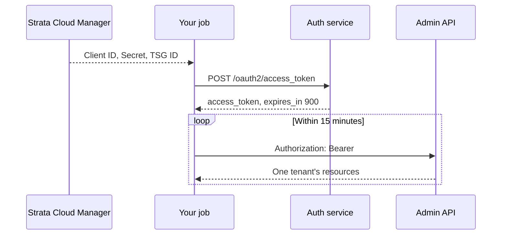

# AI Gateway Admin API authentication

Pasted from Portkey's docs (<https://docs.portkey.ai/docs/aigw/api-reference/admin-api/authentication.md>),
2026-10-28. Kept here because the gateway's OpenAPI spec does not document
this flow at all — it only declares `securitySchemes.Authorization: bearer`,
with no token endpoint. See `CLAUDE.md` for how this maps into
`app/gateway.py`.

## Authentication

> Authorise Admin API requests with a Strata Cloud Manager access token issued to a service account

Admin API requests are authorised with a short-lived access token issued by Strata Cloud Manager, not with an AI Gateway API key.

> [!WARNING]
>
> A gateway API key, the key you send as `Authorization: Bearer $API_KEY` on inference requests, is **not** accepted on any Admin API endpoint. See [Inference API authentication](https://docs.portkey.ai/docs/aigw/api-reference/inference-api/authentication.md) for the inference path.

You obtain an Admin API token by authenticating a **service account** against the Palo Alto Networks authentication service. The token carries the ID of the tenant service group (TSG) it was scoped to, and every request made with it is routed to that tenant.



## What you need

Before you can request a token, three values must exist. All three come from Strata Cloud Manager.

| Value | What it identifies | Where it comes from |
| :- | :- | :- |
| TSG ID | The tenant the token will act on. One TSG corresponds to one AI Gateway organisation. | Shown against the tenant in Strata Cloud Manager |
| Client ID | The service account | Issued when the service account is created |
| Client Secret | The service account's credential | Shown **once**, at creation |

> [!NOTE]
>
> A TSG must have a service account before you can make any API call against it. If a tenant has no service account of its own, a service account belonging to one of its ancestor TSGs can be used instead. See [Token scope within a TSG hierarchy](#token-scope-within-a-tsg-hierarchy).
>
> One TSG may have many service accounts, and one service account may have many tokens.

> [!NOTE]
>
> *Tenant service group* and *tenant* are used interchangeably; there is no functional difference between them.

## Create a service account

Service accounts are created in Strata Cloud Manager, through Common Services Identity & Access. A service account is not tied to a specific user.

**1. Open Identity & Access**

Sign in to [Strata Cloud Manager](https://stratacloudmanager.paloaltonetworks.com/) and go to **System Settings > Identity & Access**.

**2. Select the tenant**

Choose the tenant the service account belongs to.

A service account added to a parent tenant is automatically added to all of that tenant's children, which is how a parent manages its children. Add it to a child tenant instead if you do not want that inheritance.

Creating service accounts in different tenant service groups lets you assign different roles for different access permissions, and keeps the audit trail readable.

**3. Add the identity**

Select **Add** (or **Add Identity**), then set **Identity Type** to **Service Account**.

Give it a unique and meaningful **Service Account Name**. Optionally add a **Service Account Contact** email and a **Description**. The contact person is not added as a user.

**4. Save the client credentials**

Select **Next**. The Client Credentials screen shows the **Client ID** and **Client Secret**.

> [!WARNING]
>
> The Client Secret is presented once. Copy both values, or select **Download CSV File**, before leaving the screen. If you lose the secret you must issue a new credential.

**5. Note the TSG ID**

Select **Next**. The display name of the service account is formatted as `<ServiceAccountName>@<tsg_id>.iam.panserviceaccount.com`.

Every service account of a parent tenant carries the parent TSG ID, and every service account of a child tenant carries the child TSG ID. Take note of the `tsg_id`, because you pass it on every token request.

**6. Assign a role**

On the Assign Roles screen, select the scope (for example **All Apps & Services**) and assign the role the service account needs. A service account with no role assignment cannot obtain a token.

Grant the narrowest role that covers the Admin API operations you intend to automate. A custom role needs `iam.service_account` and `iam.custom_role` permissions if the account will manage identities itself.

**7. Submit**

Save to create the service account. You now have the Client ID, Client Secret and TSG ID needed to request a token.

## Request an access token

Exchange the service account credentials for an access token with `POST /oauth2/access_token`.

> [!WARNING]
>
> The authentication service runs on a different FQDN from the rest of Strata Cloud Manager:
> `https://auth.apps.paloaltonetworks.com`

The endpoint uses basic auth, with the Client ID as the username and the Client Secret as the password, and takes the TSG ID in the `scope` field:

```sh Request an access token theme={"system"}
curl -d "grant_type=client_credentials&scope=tsg_id:<tsg_id>" \
  -u <client_id>:<client_secret> \
  -H "Content-Type: application/x-www-form-urlencoded" \
  -X POST https://auth.apps.paloaltonetworks.com/oauth2/access_token
```

The service account you authenticate with must belong to the TSG named on `scope`, or to one of its ancestors.

A successful response carries the token and its lifetime in seconds:

```json theme={"system"}
{
  "access_token": "eyJhbGciOi...",
  "token_type": "Bearer",
  "expires_in": 900
}
```

> [!NOTE]
>
> **Access tokens have a lifespan of 15 minutes.** Read `expires_in` rather than hard-coding the number, cache the token in memory for the life of that window, and refresh it about a minute before it lapses. Requesting a fresh token per API call is unnecessary; carrying one across a long-running job is what fails.

## Call an Admin API endpoint

Send the token as a bearer token. Every Admin API endpoint takes the same header; the base URL and path for each one are shown on its own reference page.

```sh theme={"system"}
curl https://api.apps.paloaltonetworks.com/ai_gw/v2/configs \
  -H "Authorization: Bearer $ACCESS_TOKEN" \
  -H "Content-Type: application/json"
```

You do not pass the TSG ID on the request. The token already contains it, and the request is routed to that tenant on the strength of it.

## Token scope within a TSG hierarchy

A token issued for one TSG cannot be used against another. If you have a tenant, Tenant 1A, with a service account named `1a_svc`, then a token obtained through `1a_svc` reaches Tenant 1A and nothing else.

When you run multiple tenants you organise them as a hierarchy of TSGs. Creating a dedicated service account for every TSG and tenant in that hierarchy is the simplest arrangement, but it is not necessary. **A service account belonging to a TSG can name any descendant of that TSG when it requests a token.**

> [!NOTE]
>
> The TSG IDs used in the examples on this page are deliberately fake. Real TSG IDs are 10-digit integers, such as `1000000001`.

### Grant cross-hierarchy access with an access policy

Where a service account needs a token for a TSG outside its own subtree, an **access policy** on the target tenant can name that service account's Client ID as the principal. See the full doc text pasted into chat on 2026-10-28 for the exact API call — trimmed here since it is not needed for this app.

## Check your token

If the credentials baked into a token are not the ones you expect, the Admin API rejects the request and the error reports an invalid authorisation code.

Paste the token into [jwt.io](https://jwt.io/) to decode it and read the claims back. The decoded payload shows the `tsg_id` the token was issued for, which is the fastest way to confirm you are hitting the tenant you think you are, and an `access` claim listing the roles the service account holds on it.

### Common failures

| Symptom | Cause |
| :- | :- |
| Token request rejected at `/oauth2/access_token` | The Client ID or Client Secret is wrong, or the service account has no role assignment |
| Token request rejected for the TSG on `scope` | The service account is not in that TSG or an ancestor of it. Create an access policy |
| Admin API returns an authorisation error with a valid-looking token | The token has expired, since they last 15 minutes, or it is scoped to a different tenant. Decode it and check `tsg_id` |
| Admin API rejects a key that works for inference | A gateway API key was sent instead of an access token. Only tokens from the authentication service are accepted |
